<div align="center">
  
  <h1>Tally</h1>
  <p><strong>A self-hosted food diary and nutrition tracker for the UK, for your whole household.</strong></p>

  [](https://github.com/joecrockett5/tally/actions/workflows/ci.yml)
  [](https://github.com/joecrockett5/tally/releases)
  [](https://github.com/joecrockett5/tally/pkgs/container/tally)
  [](#quick-start)
  [](LICENSE)
</div>

<p align="center">
  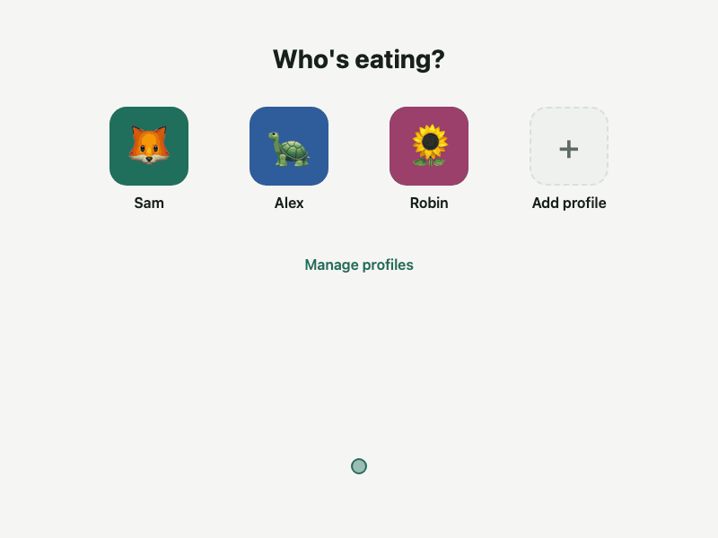
</p>

## Contents

- [Features](#features)
- [Screenshots](#screenshots)
- [Quick start](#quick-start)
- [Configuration](#configuration)
- [Updating and versions](#updating-and-versions)
- [Your data](#your-data)
- [Deploying](#deploying)
- [Development](#development)
- [License and credits](#license-and-credits)

## Features

- **UK nutrition labels:** energy (kcal and kJ), fat, saturates, carbohydrate, sugars, fibre, protein and salt. Unknown values show as “–”, never as 0.
- **Food data from free sources:** about 2,900 UK generic foods from CoFID, plus Open Food Facts for packaged products, with UK products ranked first.
- **Barcode scanning:** EAN-13, EAN-8, UPC-A and UPC-E, or type the number in.
- **Your own foods:** per 100 g, per 100 ml or per portion, under a restaurant if you like, private or shared. [Bulk import](docs/IMPORT.md) from CSV or JSON.
- **Recipes and saved meals:** nutrition worked out from the ingredients; log a usual meal in one tap, or copy meals between days.
- **Goals:** daily targets for each profile, starting from UK Reference Intakes.
- **History:** weekly and monthly charts, averages, macro split and CSV export.
- **History that stays true:** entries keep the values from when you logged them, so later edits to a food never change your past days.
- **Profiles, not accounts:** a picker for everyone in the household. There are **no passwords by design**, so run it only for people you trust, on a private network or behind your proxy.
- **Installable:** a mobile-first app you can add to your home screen. Diary data always comes from your server; there's no offline logging.

## Screenshots

| | Desktop | Phone |
|---|---|---|
| **Diary** | 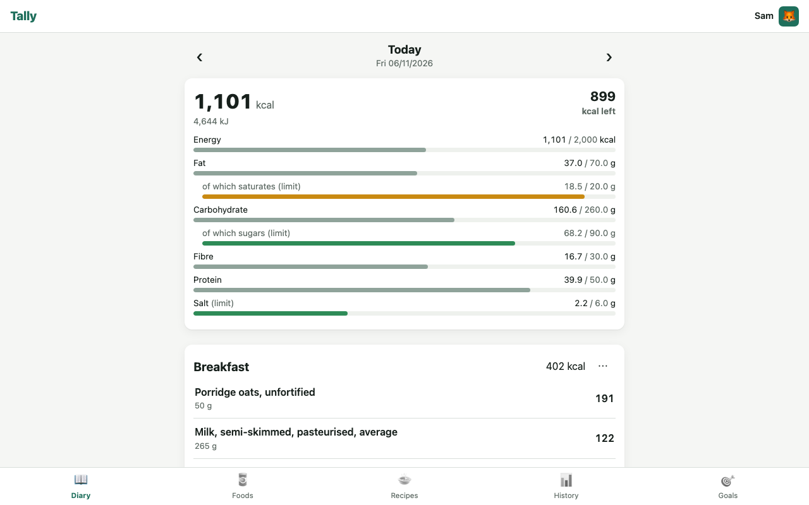 | 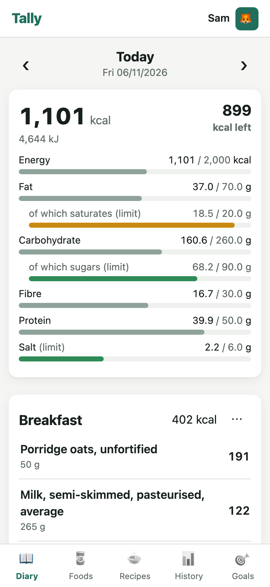 |
| **Food search** | 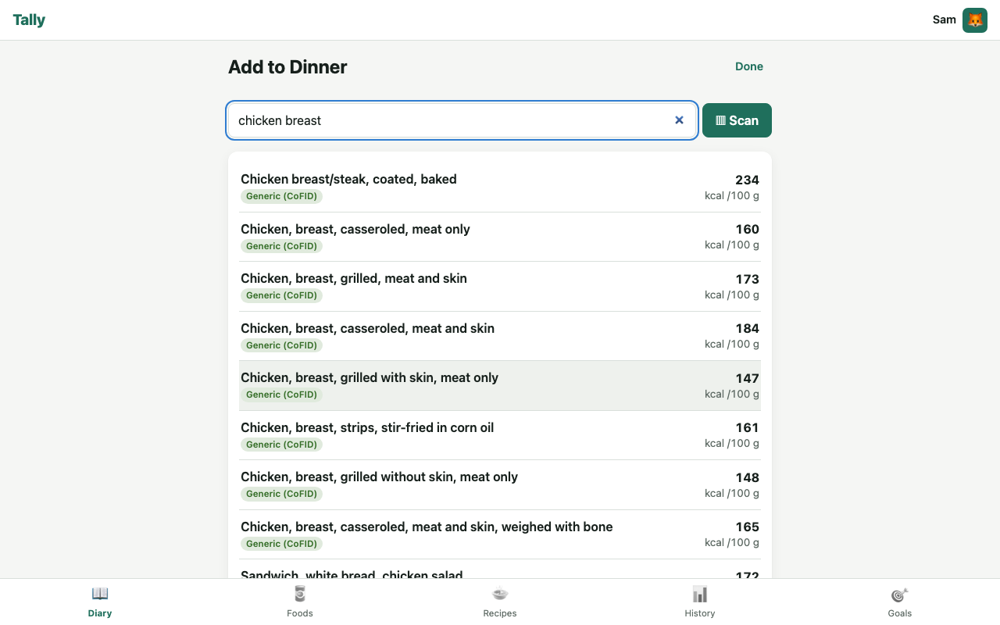 | 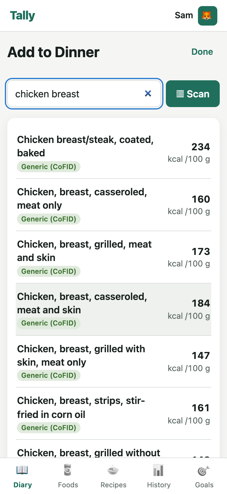 |
| **Recipes** | 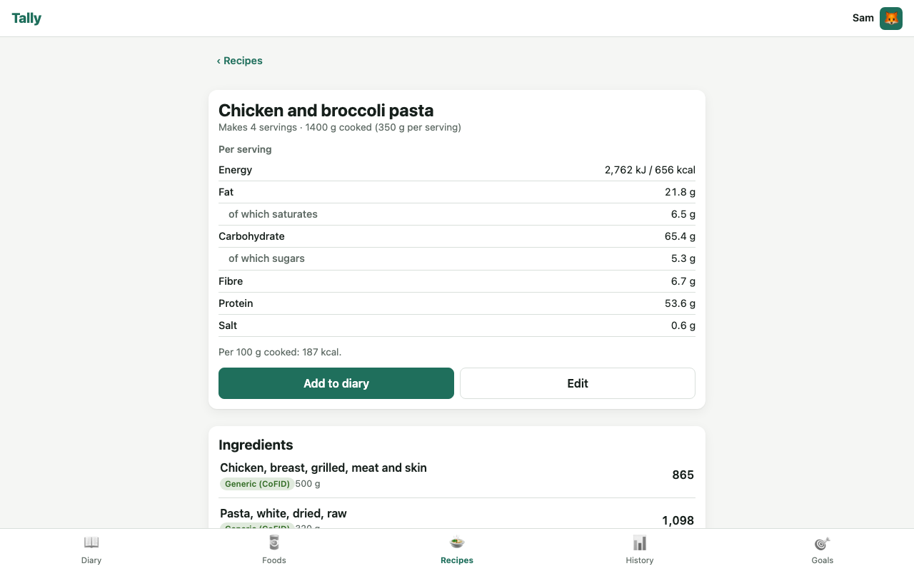 | 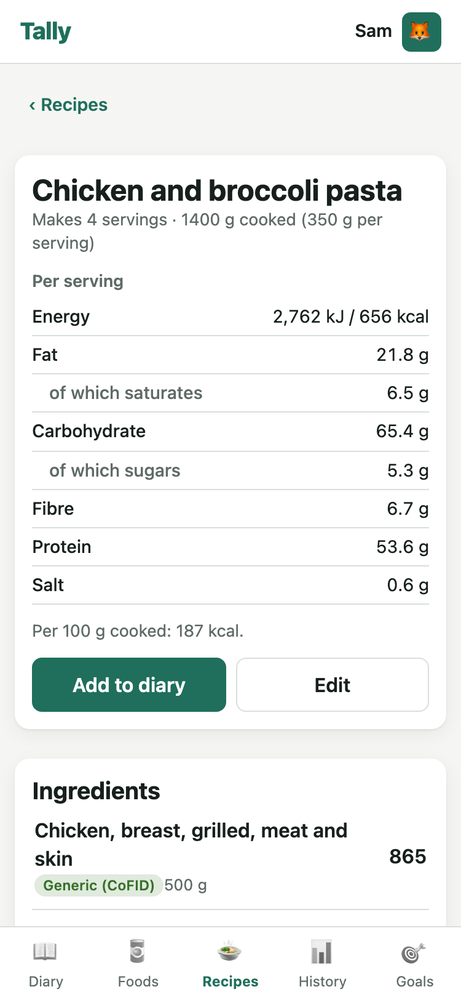 |
| **History** | 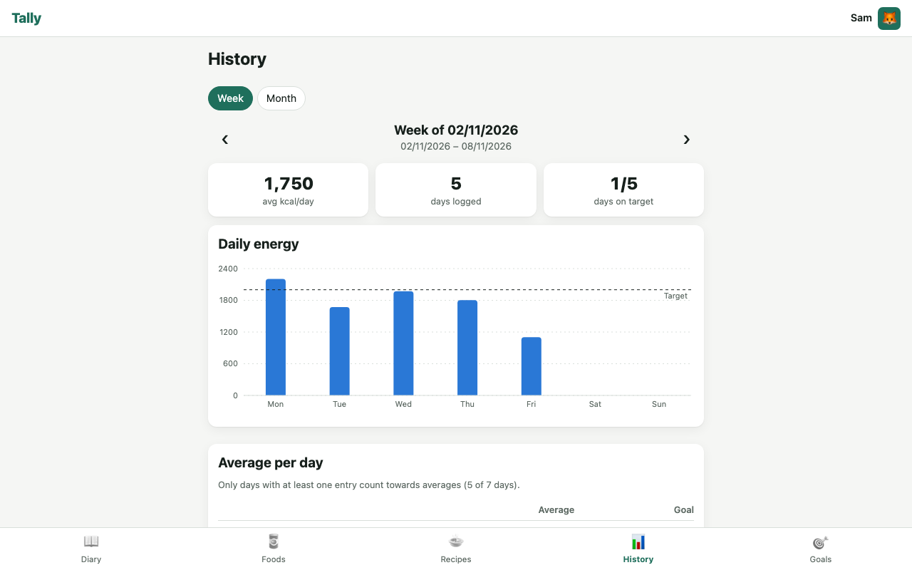 | 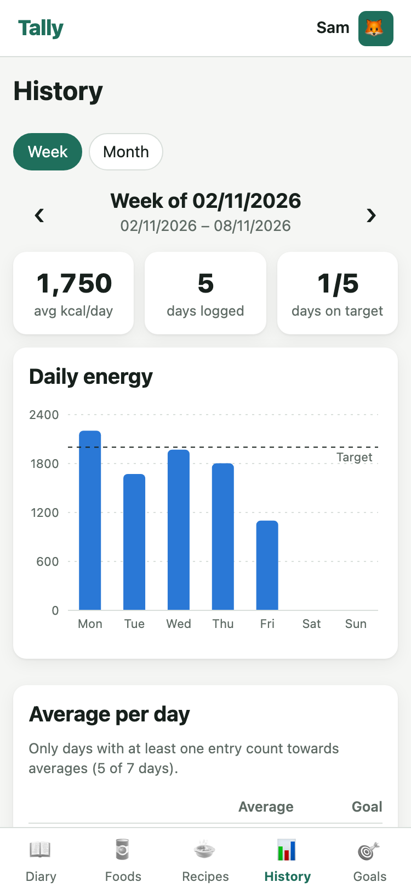 |
| **Goals** | 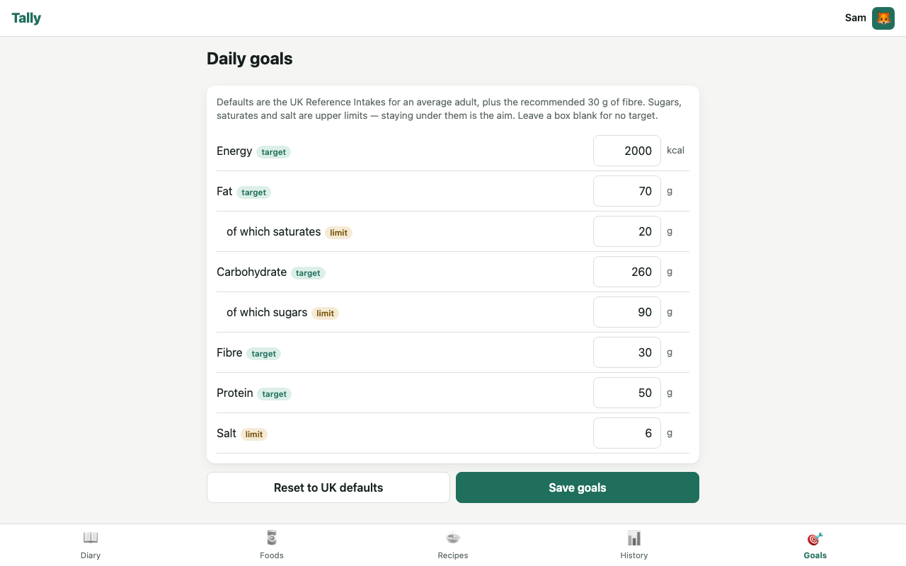 | 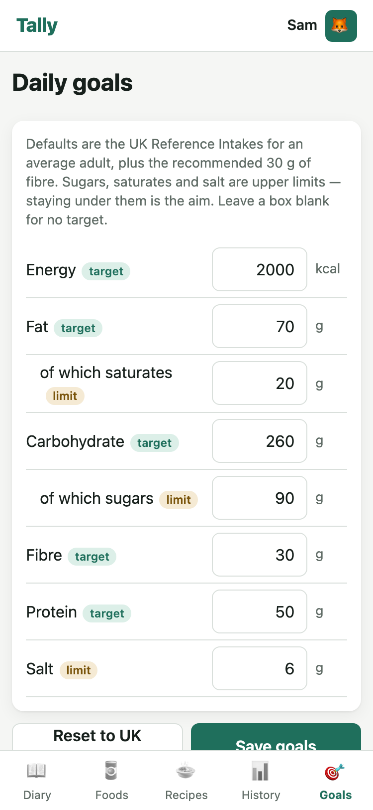 |
| **Profiles** | 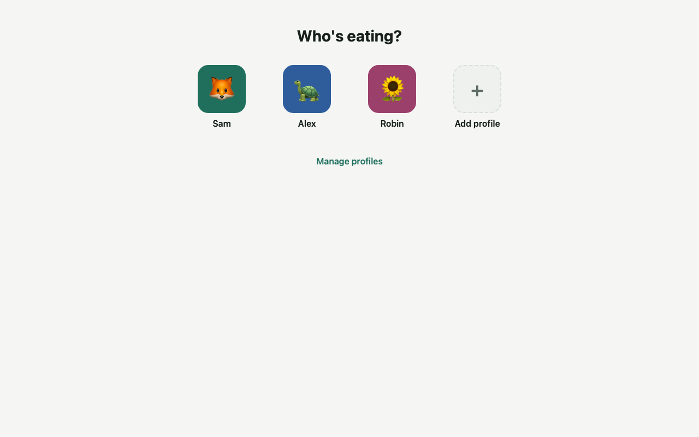 | 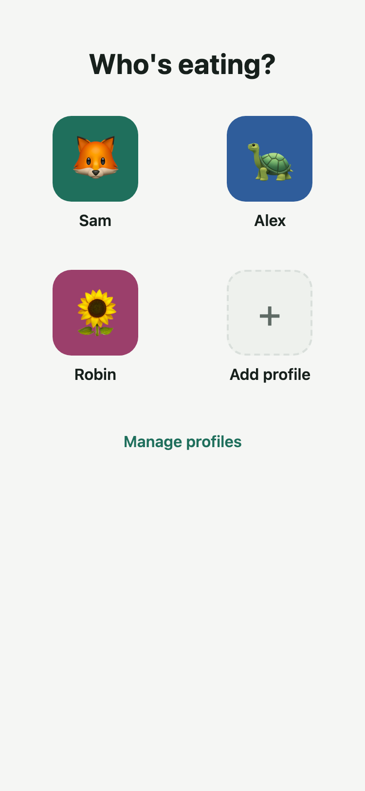 |

These show the real app with made-up demo data. The people and the restaurant are fictional, and no photos are used.

## Quick start

You only need Docker with the Compose plugin. There's nothing to clone or build.

**1. Create a folder with this `docker-compose.yml` in it:**

```yaml
# Runs the published image. All settings have defaults except POSTGRES_PASSWORD;
# set them in a .env file next to this one (see .env.example).
# To build this checkout instead, see docker-compose.build.yml.
name: tally

services:
  db:
    image: postgres:18-alpine
    restart: unless-stopped
    environment:
      POSTGRES_USER: ${POSTGRES_USER:-tally}
      # Required. Use letters and digits only: it is also embedded in the app's connection string.
      POSTGRES_PASSWORD: ${POSTGRES_PASSWORD:?Set POSTGRES_PASSWORD in .env}
      POSTGRES_DB: ${POSTGRES_DB:-tally}
      TZ: ${TALLY_TIMEZONE:-Europe/London}
    volumes:
      # All of Tally's data. Postgres 18 keeps PGDATA under /var/lib/postgresql/<major>/docker.
      - tally-db:/var/lib/postgresql
    healthcheck:
      test: ["CMD-SHELL", "pg_isready -U \"$${POSTGRES_USER}\" -d \"$${POSTGRES_DB}\""]
      interval: 10s
      timeout: 5s
      retries: 10
      start_period: 20s

  app:
    # VERSION: an image tag such as 1.0.0, 1.0 or 1. Defaults to the latest stable release.
    image: ghcr.io/joecrockett5/tally:${VERSION:-latest}
    restart: unless-stopped
    depends_on:
      db:
        condition: service_healthy
    ports:
      # APP_PORT: the HTTP port, inside and outside the container.
      - "${APP_PORT:-8080}:${APP_PORT:-8080}"
    environment:
      ASPNETCORE_HTTP_PORTS: ${APP_PORT:-8080}
      # TALLY_TIMEZONE: IANA timezone that decides which calendar day "today" is.
      TZ: ${TALLY_TIMEZONE:-Europe/London}
      Tally__TimeZone: ${TALLY_TIMEZONE:-Europe/London}
      ConnectionStrings__Tally: "Host=db;Port=5432;Database=${POSTGRES_DB:-tally};Username=${POSTGRES_USER:-tally};Password=${POSTGRES_PASSWORD};Gss Encryption Mode=Disable"
      # OFF_ENABLED: false turns off all online Open Food Facts lookups.
      Tally__OpenFoodFacts__Enabled: ${OFF_ENABLED:-true}
      # OFF_CONTACT_EMAIL: sent to Open Food Facts in the User-Agent, as they ask every app to do.
      Tally__OpenFoodFacts__ContactEmail: ${OFF_CONTACT_EMAIL:-}
      # Cache lifetimes: products refresh after N days; missing barcodes and searches are remembered for N hours.
      Tally__OpenFoodFacts__ProductCacheDays: ${OFF_PRODUCT_CACHE_DAYS:-30}
      Tally__OpenFoodFacts__NotFoundCacheHours: ${OFF_NOT_FOUND_CACHE_HOURS:-24}
      Tally__OpenFoodFacts__SearchCacheHours: ${OFF_SEARCH_CACHE_HOURS:-24}

volumes:
  tally-db:
```

**2. Choose a database password.** Open Food Facts also asks every app for a contact email, so put yours here:

```bash
echo "POSTGRES_PASSWORD=$(openssl rand -hex 24)" > .env
echo "OFF_CONTACT_EMAIL=you@example.com" >> .env
```

**3. Start it:**

```bash
docker compose up -d
```

**4. Open <http://localhost:8080>** (or `http://<server>:8080` from another device) and add your first profile. The first start takes a few seconds while Tally sets up its database and loads the CoFID foods.

To check it's running:

```bash
curl http://localhost:8080/healthz
```

```json
{"ok":true,"version":"1.0.0"}
```

The camera and “Add to Home Screen” need HTTPS on phones, so see [Deploying](#deploying) before you hand it to the household.

<details>
<summary>Prefer <code>docker run</code>?</summary>

```bash
POSTGRES_PASSWORD=$(openssl rand -hex 24)

docker network create tally

docker run -d --name tally-db --network tally --restart unless-stopped \
  -e POSTGRES_USER=tally \
  -e POSTGRES_PASSWORD="$POSTGRES_PASSWORD" \
  -e POSTGRES_DB=tally \
  -v tally-db:/var/lib/postgresql \
  postgres:18-alpine

docker run -d --name tally-app --network tally --restart unless-stopped \
  -p 8080:8080 \
  -e "ConnectionStrings__Tally=Host=tally-db;Port=5432;Database=tally;Username=tally;Password=$POSTGRES_PASSWORD;Gss Encryption Mode=Disable" \
  -e Tally__OpenFoodFacts__ContactEmail=you@example.com \
  ghcr.io/joecrockett5/tally:latest
```

Tally retries its database connection on start, so it's fine that Postgres takes a moment to come up.

</details>

## Configuration

Set these in the `.env` file next to `docker-compose.yml`, then run `docker compose up -d` again.

| Variable | Default | Meaning |
|---|---|---|
| `POSTGRES_PASSWORD` | none, **required** | Database password. Use letters and digits only, because it also goes into the app's connection string. |
| `POSTGRES_USER` | `tally` | Database user. |
| `POSTGRES_DB` | `tally` | Database name. |
| `VERSION` | `latest` | Image tag to run. See [Updating and versions](#updating-and-versions). |
| `APP_PORT` | `8080` | HTTP port, inside and outside the container. |
| `TALLY_TIMEZONE` | `Europe/London` | IANA timezone that decides which calendar day “today” is. Diary days are stored as local dates, so entries don't jump days at midnight or when the clocks change. |
| `OFF_CONTACT_EMAIL` | empty | Sent to Open Food Facts in the User-Agent (`Tally/<version> (<email>)`), as they ask every app to do. |
| `OFF_ENABLED` | `true` | `false` turns off all online lookups, leaving your own foods and CoFID. |
| `OFF_PRODUCT_CACHE_DAYS` | `30` | Cached products are refreshed in the background after this many days. |
| `OFF_NOT_FOUND_CACHE_HOURS` | `24` | How long a “barcode not found” answer is remembered. |
| `OFF_SEARCH_CACHE_HOURS` | `24` | How long online search results are remembered. |

<details>
<summary>Variables on the app container</summary>

The compose file maps the settings above onto these. With `docker run`, set them directly. The ones marked “not in compose” need adding under `environment:` if you want to change them.

| Variable | Default | Meaning |
|---|---|---|
| `ConnectionStrings__Tally` | localhost development database | Npgsql connection string. Keep `Gss Encryption Mode=Disable`: the image has no Kerberos libraries. |
| `ASPNETCORE_HTTP_PORTS` | `8080` | Port the app listens on inside the container. |
| `TZ` | UTC | The container's system timezone. Compose sets it from `TALLY_TIMEZONE`. |
| `Tally__TimeZone` | `Europe/London` | Same as `TALLY_TIMEZONE`. |
| `Tally__OpenFoodFacts__Enabled` | `true` | Same as `OFF_ENABLED`. |
| `Tally__OpenFoodFacts__ContactEmail` | empty | Same as `OFF_CONTACT_EMAIL`. |
| `Tally__OpenFoodFacts__ProductCacheDays` | `30` | Same as `OFF_PRODUCT_CACHE_DAYS`. |
| `Tally__OpenFoodFacts__NotFoundCacheHours` | `24` | Same as `OFF_NOT_FOUND_CACHE_HOURS`. |
| `Tally__OpenFoodFacts__SearchCacheHours` | `24` | Same as `OFF_SEARCH_CACHE_HOURS`. |
| `Tally__OpenFoodFacts__ProductRequestsPerMinute` | `15` | Not in compose. Rate limit for product reads, matching Open Food Facts' published limit. |
| `Tally__OpenFoodFacts__SearchRequestsPerMinute` | `10` | Not in compose. Rate limit for searches, matching Open Food Facts' published limit. |
| `Tally__OpenFoodFacts__TimeoutSeconds` | `8` | Not in compose. Timeout for each Open Food Facts request. |
| `Tally__OpenFoodFacts__ProductBaseUrl` | `https://world.openfoodfacts.org` | Not in compose. Open Food Facts product API address. |
| `Tally__OpenFoodFacts__SearchBaseUrl` | `https://search.openfoodfacts.org` | Not in compose. Open Food Facts search API address. |
| `Tally__SeedCofid` | `true` | Not in compose. Load CoFID on start when no generic foods exist yet. |
| `Tally__CofidPath` | `data/cofid/cofid-2021.csv` | Not in compose. Path of the CoFID file, relative to the app or absolute. |
| `APP_VERSION` | set by the image | The version reported by `/healthz`. Set when the image is built; `dev` outside an image. |

</details>

## Updating and versions

Images are published to `ghcr.io/joecrockett5/tally` for `linux/amd64` and `linux/arm64`. Choose how closely to follow releases with `VERSION` in `.env`:

| Tag | Follows |
|---|---|
| `latest` | The newest stable release. This is the default. |
| `1` | The newest stable `1.x.y`. |
| `1.0` | The newest stable `1.0.y`, so bug fixes only. |
| `1.0.0` | Exactly that release, and never changes. |

Pre-releases such as `1.1.0-rc.1` are only published under their exact tag.

To update:

```bash
docker compose pull && docker compose up -d
```

Database migrations run automatically on start and can't be undone automatically, so [take a backup](#backup) first. Installed phone apps pick up the new version the next time they're opened. What changed in each release is in the [changelog](CHANGELOG.md).

## Your data

The app container is stateless. Everything you enter lives in Postgres, in one named Docker volume:

| Volume | Mounted at | Holds |
|---|---|---|
| `tally_tally-db` (just `tally-db` if you used `docker run`) | `/var/lib/postgresql` in the `db` container | Profiles, diary, foods, recipes, goals and cached Open Food Facts products. |

The only thing kept outside it is each browser's remembered profile choice.

### Backup

`pg_dump` is consistent while Tally is running:

```bash
docker compose exec -T db pg_dump -U tally -d tally -Fc > tally-$(date +%F).dump
```

Replace `tally` if you changed `POSTGRES_USER` or `POSTGRES_DB`. Schedule that with cron and copy the files off the server.

### Restore

```bash
docker compose stop app
docker compose exec -T db pg_restore -U tally -d tally --clean --if-exists < tally-2026-11-06.dump
docker compose start app
```

To restore onto a fresh machine, run `docker compose up -d db`, wait for it to be healthy, run the `pg_restore` line, then `docker compose up -d`.

### Refreshing CoFID

This reloads the bundled CoFID foods into your database:

```bash
docker compose exec app dotnet Tally.Api.dll import-cofid
```

## Deploying

Tally speaks plain HTTP, so put a reverse proxy in front of it for HTTPS. Tally reads `X-Forwarded-For`, `X-Forwarded-Proto` and `X-Forwarded-Host`, and doesn't add its own HTTPS redirect or HSTS.

> [!WARNING]
> Tally has no login, and it trusts forwarded headers from any address. **Don't expose its port directly to the internet.** Only your proxy should reach it: firewall the port, or publish it on localhost only by changing the compose `ports:` line to `"127.0.0.1:8080:8080"`. To put a gate in front of the profile picker, add basic auth or an IP allow-list at the proxy.

**Upload size:** bulk imports go through the proxy, and Tally accepts request bodies of up to 5 MB. nginx's default limit is 1 MB, so raise it as shown. Caddy has no limit by default.

### Caddy

Caddy gets a certificate automatically and sets the forwarded headers for you:

```caddyfile
tally.example.com {
	reverse_proxy localhost:8080
}
```

### nginx

```nginx
server {
    listen 443 ssl;
    server_name tally.example.com;

    ssl_certificate     /etc/letsencrypt/live/tally.example.com/fullchain.pem;
    ssl_certificate_key /etc/letsencrypt/live/tally.example.com/privkey.pem;

    client_max_body_size 5m;

    location / {
        proxy_pass http://127.0.0.1:8080;
        proxy_set_header Host $host;
        proxy_set_header X-Forwarded-For $proxy_add_x_forwarded_for;
        proxy_set_header X-Forwarded-Proto $scheme;
        proxy_set_header X-Forwarded-Host $host;
    }
}
```

### Nginx Proxy Manager

Add a proxy host with scheme `http`, your Docker host's address and port `8080`. On the SSL tab, request a certificate and tick **Force SSL**. To allow imports over 1 MB, add `client_max_body_size 5m;` on the Advanced tab.

### Phones

Browsers only allow the camera on HTTPS, or on `http://localhost` on the device itself. Over plain HTTP on a LAN address, everything works except the camera: the scanner explains why and offers manual barcode entry. Scanning uses the browser's `BarcodeDetector` where it's available and falls back to ZXing, for example on iPhone.

To install the app, open your HTTPS address, then:

- **Android (Chrome):** menu → **Install app** or **Add to Home screen**.
- **iPhone (Safari):** Share → **Add to Home Screen**.

## Development

Stack: ASP.NET Core (.NET 10) with EF Core, PostgreSQL 18, and React with TypeScript and Vite. The design notes are in [PLAN.md](PLAN.md) and [ASSUMPTIONS.md](ASSUMPTIONS.md).

### Running from source

You need the .NET 10 SDK, Node 24 and Docker.

```bash
# database
docker run -d --name tally-dev-db -e POSTGRES_USER=tally -e POSTGRES_PASSWORD=tally -e POSTGRES_DB=tally -p 5432:5432 postgres:18-alpine

# API on :5080 (matches the Vite proxy)
ASPNETCORE_URLS=http://localhost:5080 dotnet run --project src/Tally.Api

# web app on :5173
cd web && npm install && npm run dev
```

Tests:

```bash
dotnet test                 # backend: xUnit v3 + Testcontainers (starts its own Postgres)
cd web && npm test          # frontend: Vitest + React Testing Library
cd web && npm run typecheck
```

New migration: `dotnet tool restore && dotnet ef migrations add <Name> -p src/Tally.Api -o Data/Migrations`.

### Building the image from your checkout

`docker-compose.build.yml` swaps the published image for a local build:

```bash
docker compose -f docker-compose.yml -f docker-compose.build.yml up --build
```

### CI

- **Pull requests** run the backend and frontend tests. They also fail if the manifest versions disagree, or if `CHANGELOG.md` has no section for the current version.
- **Pushes to `main`** run the same checks, then look for the tag `vX.Y.Z`. If it's missing, they [publish a release](.github/workflows/release.yml). If it exists, they just build and smoke-test the image.

### Releasing

Releases happen automatically when a merge to `main` carries a new version. **Never push tags by hand.**

1. Set the version in every manifest:

   ```bash
   tools/release/set-version.sh X.Y.Z
   ```

2. In `CHANGELOG.md`, add a `## [X.Y.Z] - YYYY-MM-DD` section and update the link definitions at the bottom.
3. Open a pull request and merge it.

CI then builds and pushes the multi-arch image, smoke-tests it, and creates the tag and GitHub Release using the changelog section as the notes. A version containing `-`, such as `1.1.0-rc.1`, becomes a pre-release and doesn't move `latest`, `1` or `1.1`.

### Refreshing the README media

```bash
node tools/media/seed-demo.mjs http://localhost:8080
```

Run that against a fresh instance with `OFF_ENABLED=false`, then follow the steps at the top of [`tools/media/capture.cjs`](tools/media/capture.cjs) to retake the screenshots and GIF.

## License and credits

Tally is released under the [MIT License](LICENSE). Bundled and runtime dependencies are listed with their licences in [THIRD_PARTY_NOTICES.md](THIRD_PARTY_NOTICES.md). To report a vulnerability, see [SECURITY.md](SECURITY.md).

- **CoFID:** *McCance and Widdowson's Composition of Foods Integrated Dataset 2021*, Office for Health Improvement and Disparities, © Crown copyright, [Open Government Licence v3.0](https://www.nationalarchives.gov.uk/doc/open-government-licence/version/3/). Converted from the published spreadsheet by [`tools/cofid/convert.py`](tools/cofid/convert.py), which documents the conventions: trace → 0, not measured → unknown, salt from sodium, AOAC fibre with NSP fallback.
- **Open Food Facts:** product data © Open Food Facts contributors, [Open Database Licence](https://opendatacommons.org/licenses/odbl/1-0/). Tally uses the product API (v3) and Search-a-licious, respects the published rate limits, caches results in your database, and shows attribution wherever this data appears.
